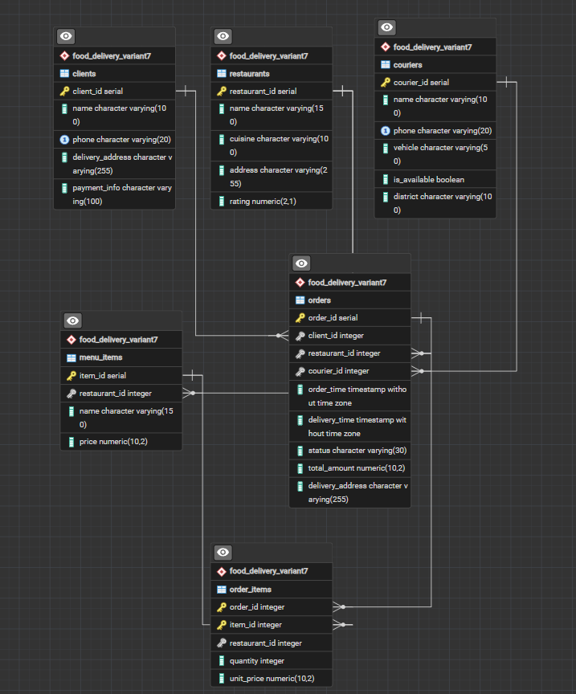

# База даних сервісу доставки їжі

Проєктування бази даних для сервісу доставки їжі, який з'єднує ресторани, клієнтів та кур'єрів, а також обробляє замовлення та їхні позиції.

---

## Схема бази даних

### Таблиці

| Таблиця | Опис |
|---|---|
| `Restaurants` | Ресторани - назва, кухня, адреса, рейтинг |
| `Clients` | Клієнти - ім'я, телефон, адреса доставки, платіжна інформація |
| `Couriers` | Кур'єри - ім'я, телефон, транспортний засіб, статус доступності, район |
| `Menu_Items` | Позиції меню - ресторан, назва страви, ціна |
| `Orders` | Замовлення - клієнт, ресторан, кур'єр, час замовлення, час доставки, статус, загальна сума, адреса доставки |
| `Order_Items` | Позиції замовлення - страви з ресторану, кількість, ціна на момент замовлення |

### Діаграма

---

## OLTP запити

### INSERT

- Додавання нового клієнта
- Додавання нової позиції в меню ресторану

### UPDATE

- Оновлення адреси доставки клієнта
- Зміна транспортного засобу кур'єра

### DELETE

- Видалення нової позиції меню, яку ще не замовляли
- Видалення запису про клієнта без замовлень

### SELECT

- Знайти всіх доступних кур'єрів у конкретному районі
- Вивести список усіх замовлень для ресторану за сьогодні

---

## OLAP запити

| Запит | Опис |
|---|---|
| Загальний дохід | Обчислити загальний дохід кожного ресторану за поточний місяць за доставленими замовленнями |
| Топ ресторанів | Знайти топ-10 ресторанів, упорядкованих за рейтингом та кількістю замовлень |
| Час доставки | Обчислити середній час доставки для кожного кур'єра |
| Скасовані доставки | Визначити кур'єрів з найбільшою кількістю скасованих доставок (через CTE) |
